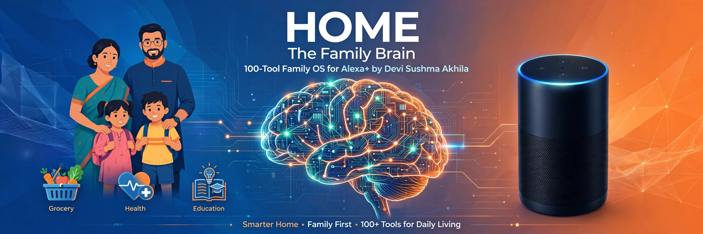
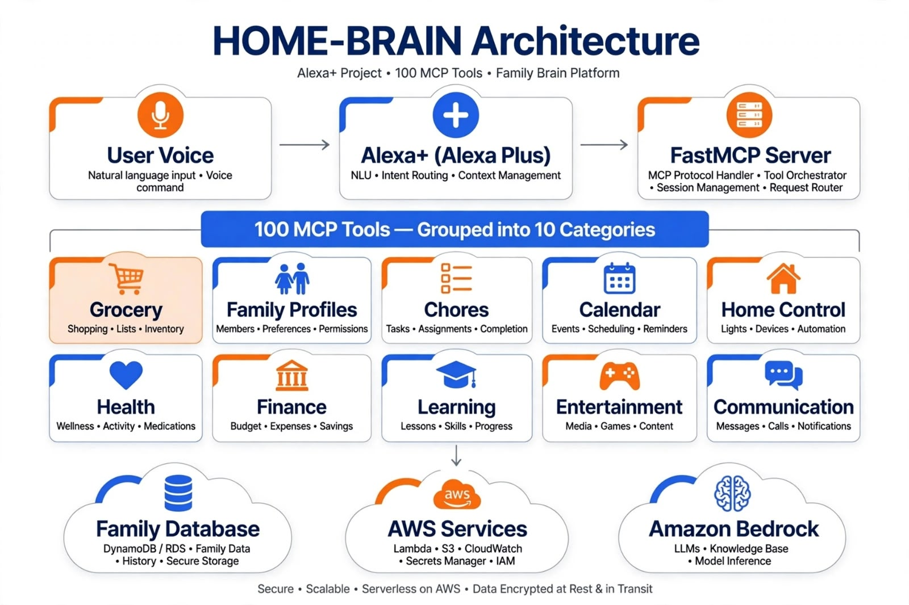

# HOME - The Family Brain 🧠
### 100-Tool Family OS for Alexa+ | Smarter Home • Family First
> Built by Devi Sushma Akhila | Vijayawada, India 🇮🇳

[](https://youtube.com)
[]()

**HOME is India's first Family Operating System that turns Alexa+ into your family's brain with 100 MCP tools.**

## 🎥 Demo Video (90 sec)
Link: PASTE_YOUR_YOUTUBE_LINK_HERE

## 🧠 Architecture


## 🛠️ 100 MCP Tools - 10 Categories
- 🛒 Grocery: add_grocery, pantry_check, meal_plan...
- 👨‍👩‍👧 Family: who_is_home, family_status...
- ✅ Chores: create_chore, assign_chore...
- 🗓️ Calendar: add_event, birthday_reminder...
- 🏠 Home Control: light_control, security_status...
- ❤️ Health: wellness_check, medication_reminder...
- 💰 Finance: budget_track, expense_add...
- 📚 Learning: lesson_plan, progress_track...
- 🎮 Entertainment: media_suggest, game_time...
- 💬 Communication: family_message, announcement...

## 🔒 Privacy First
Family data encrypted on AWS. Family owns data.

## 🚀 Quick Start
```bash
pip install fastmcp
python main.py
